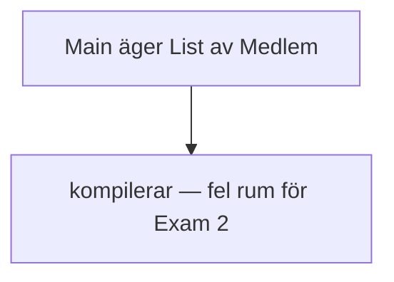
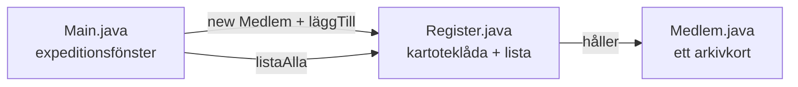
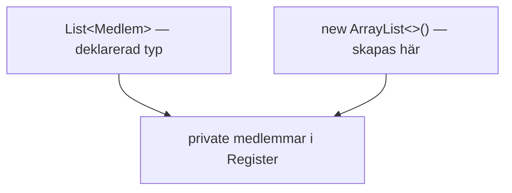
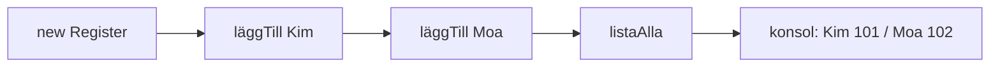
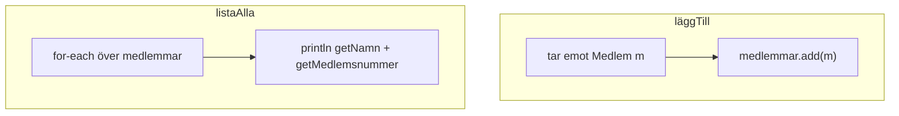
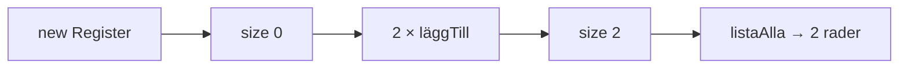
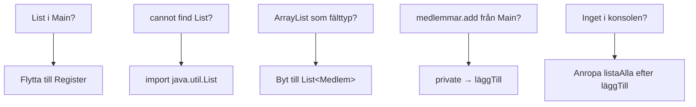
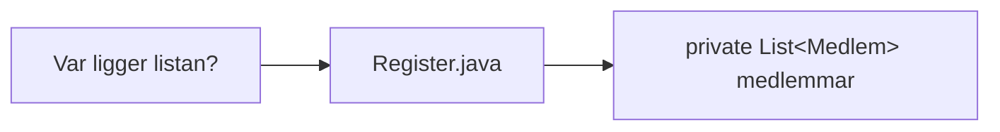

# 02 — Visuellt: kartoteklådan, skylt, två kort

Samma bilder som i teoriguiden — nu som flöde. Listan i `Register`, `List` vs `ArrayList`, `läggTill` / `listaAlla`, två medlemmar från `Main`. GitHub renderar diagrammen automatiskt.

---

## Problemet — lådan i expeditionsfickan

**Kom ihåg / INTE:** Att det kör betyder **inte** att listan ligger rätt. Exam pekar i `Register`.

---

## Tre rum — lådan får innehåll

**Vad diagrammet visar:** `Main` skapar kort och anropar. `Register` **äger** samlingen.  
**Målsvar (säg högt / skriv i README):** *“Listan bor i Register. Main har bara en Register-referens.”*

---

## Skylt vs innehåll — `List` / `ArrayList`

**Kom ihåg / INTE:** Skylten är `List`. Innehållet skapas med `ArrayList`. Deklarera **inte** fältet som `ArrayList` om du följer kursmönstret.

---

## Pipeline — från fönster till låda

**Vad du ska se:** Två rader. Bevis att `add` lagrat och loopen läst via getters.

---

## `läggTill` vs `listaAlla`

**Kom ihåg / INTE:** `läggTill` **ändrar** listan. `listaAlla` **läser** och skriver. Ingen av dem är sök.

---

## Tom låda vs två kort

**Kom ihåg / INTE:** Tom utskrift före `läggTill` = förväntat. Inte bevis att fältet saknas.

---

## Ansvarskarta — felsök rätt rum

---

## Exam-peka

**Målsvar (säg högt / skriv i README):** *“Jag öppnar Register och pekar på medlemmar — inte Main.”*

---

## Checkpoint (privat)

Säg högt: fel rum (lista i Main), skylt vs innehåll, `läggTill`/`listaAlla`, två rader i konsolen, exam-pekning. Jämför sen med diagrammen.

När kartan sitter: [03 — Övningar](./03-ovningar.md).
