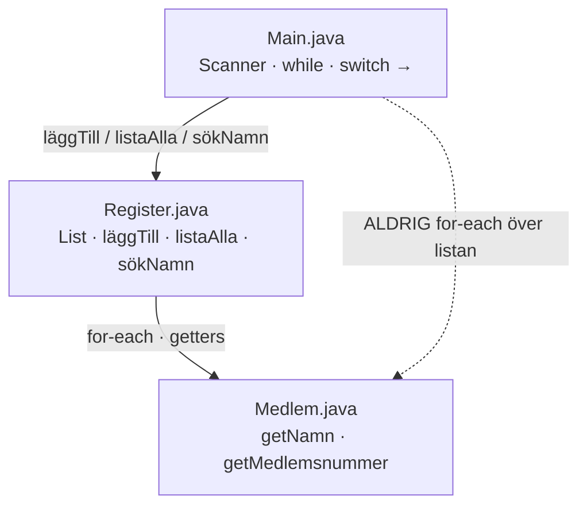
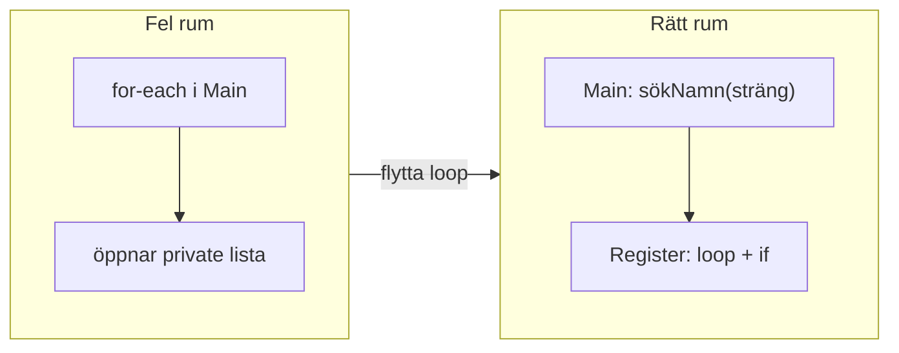
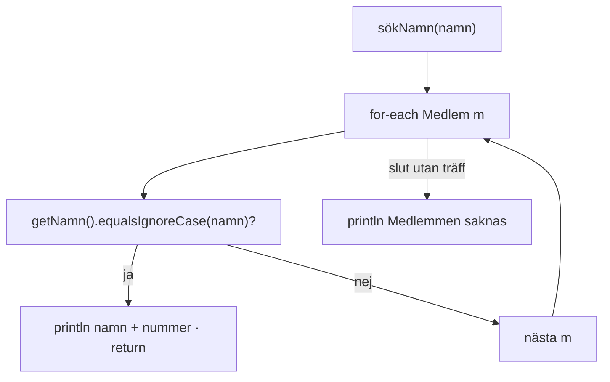
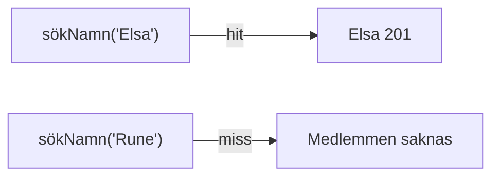
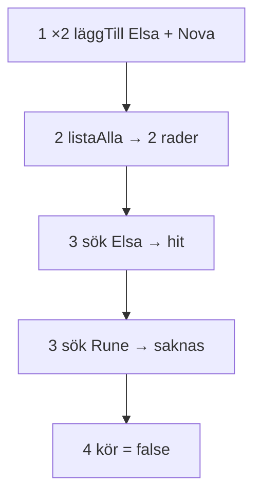
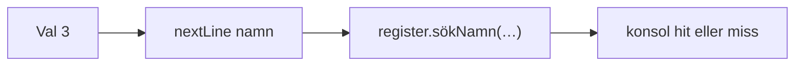
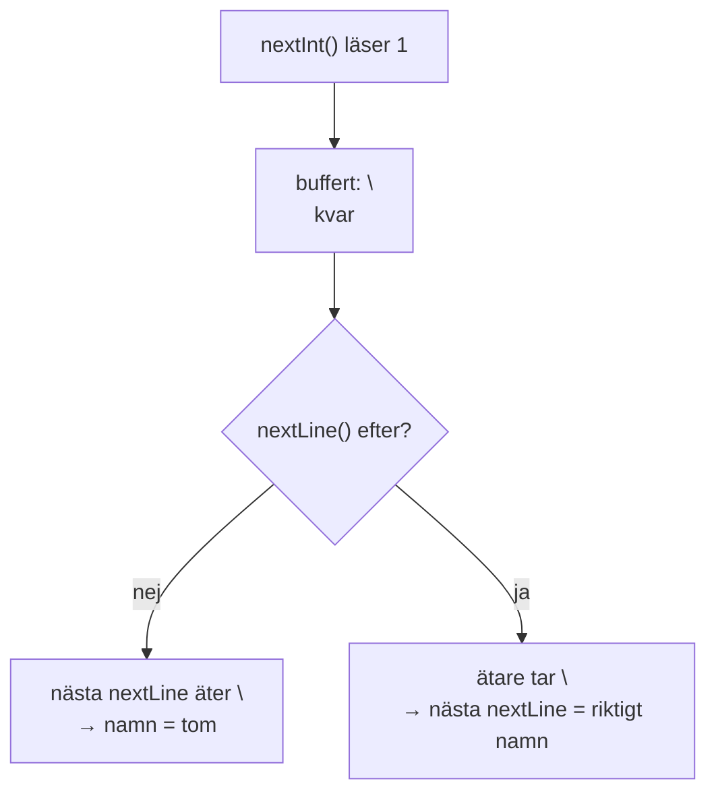
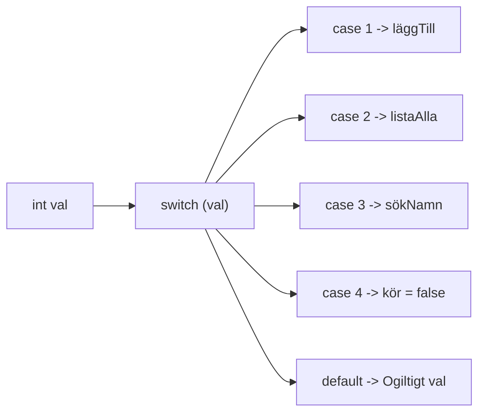

# 02 — Visuellt: sök och meny

Samma idéer som i teoriguiden — nu som flöde. `sökNamn` hit/miss, meny 1–4, Scanner-fälla. GitHub renderar diagrammen automatiskt.

---

## Tre filer — ansvar

**Vad diagrammet visar:** Main frågar. Register söker och listar. Medlem ger namn/nummer via getters.  
**Kom ihåg / INTE:** Pil från Main till “loopa medlemmar” ska inte finnas.

---

## Anti: sök i Main → flytta till Register

**Målsvar (säg högt):** *“Main anropar. sökNamn i Register gör jobbet.”*

---

## `sökNamn` — hit vs miss

**Kom ihåg / INTE:** Miss-raden hör **efter** loopen — inte i `else` varje varv. Hit utan `return` = loopen fortsätter i onödan.

---

## Konsol sida vid sida

**Vad diagrammet visar:** Samma metod. Olika sträng. Ett svar ut.

---

## Meny 1–4 — Exam-flöde

**Målsvar (säg högt):** *“Två medlemmar, lista, hit, miss, exit — sedan pekar jag på sökNamn.”*

---

## case 3 — Main frågar, Register svarar

**Kom ihåg / INTE:** case 3 ska **inte** innehålla for-each. Bara fråga + anrop.

---

## Scanner-fälla — `\n` efter `nextInt`

**Kom ihåg / INTE:** Tomt namn är nästan alltid glömd `nextLine()` — inte “Scanner trasig”.

---

## Switch expression

**Kom ihåg / INTE:** `case n ->` (Java 21). Undvik klassisk `break`-switch när uttrycksformen räcker.

---

## Checkpoint (privat)

Säg högt: var sök bor, hit vs miss, varför meny i Main, varför `nextLine` efter `nextInt`. Jämför sen med diagrammen.

När kartan sitter: [03 — Övningar](./03-ovningar.md).
