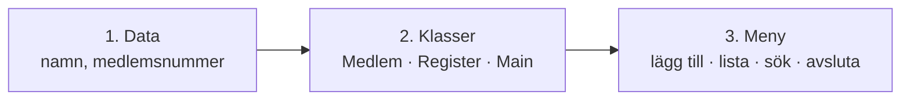
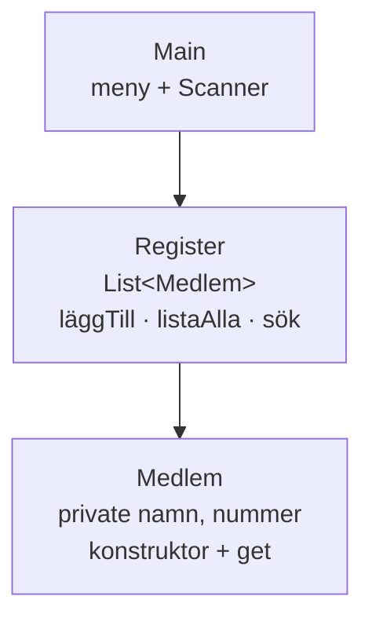
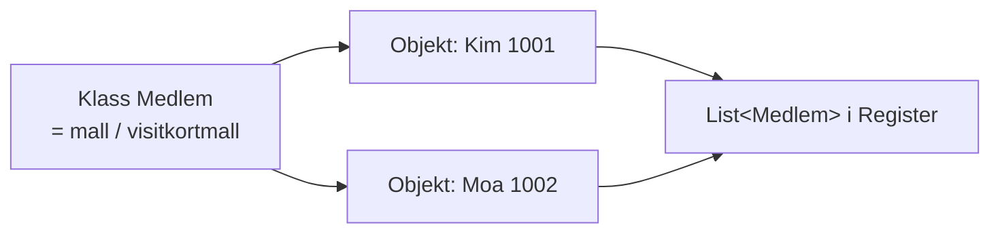
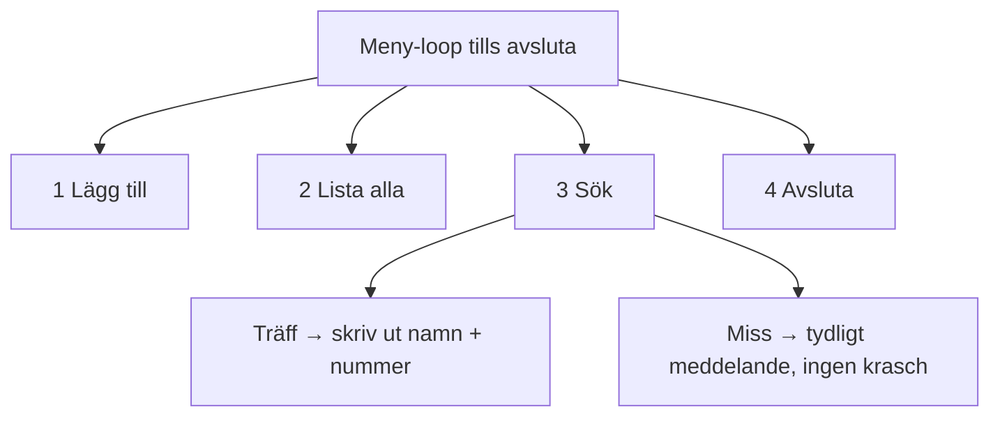
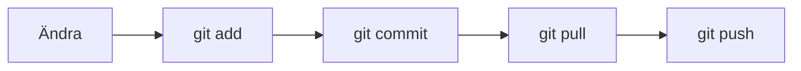
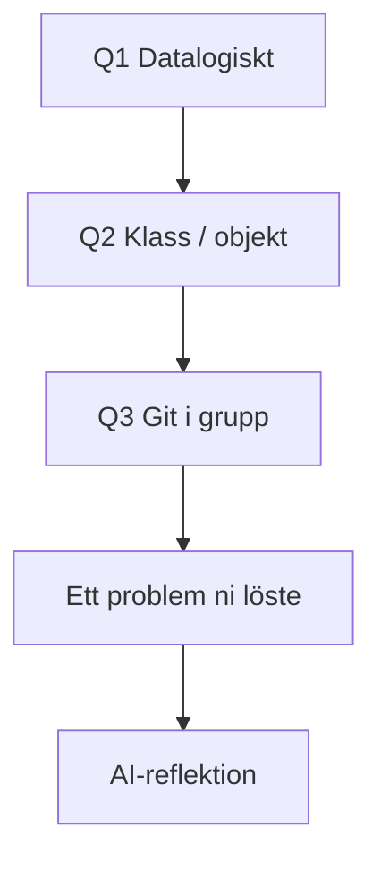
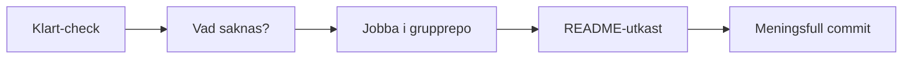
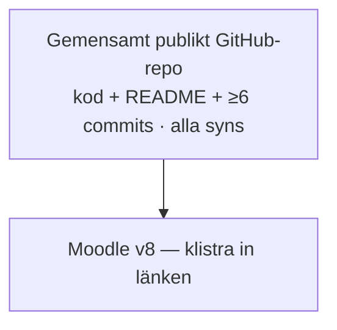

# 02 — Visuellt: nedbrytning, Klart-check och examination

Samma bilder som i teoriguiden — nu som flöde. GitHub renderar diagrammen automatiskt.

---

## Datalogiskt — data → klasser → meny

**Vad diagrammet visar:** Ordning före (och under) kod — inte “allt i Main”.  
**Kom ihåg / INTE:** INTE tom fras “vi planerade”.

**Målsvar (säg högt / skriv i README):** *“Datalogiskt = data → klasser → meny.”*

---

## Tre rum — ansvar

**Vad diagrammet visar:** Disken anropar pärmen; pärmen håller visitkort.  
**Kom ihåg / INTE:** INTE lista av råa `String` i `Main` som enda modell.

---

## Klass vs objekt

**Målsvar (säg högt / skriv i README):** *“Klassen är mallen. Objektet är en konkret medlem i listan.”*

**Kom ihåg / INTE:** INTE “klass = bara en fil utan objekt”.

---

## Meny + sök träff/miss

**Kom ihåg / INTE:** Miss är **krav** — inte “bara om vi hinner”.

---

## Git i grupp — flöde

**Vad diagrammet visar:** Pull **före** push när ni delar remote.  
**Kom ihåg / INTE:** INTE PR som examkrav. INTE sex commits sista kvällen utan att alla syns.

**Målsvar (säg högt / skriv i README):** *“Ändra → add → commit → pull → push. Alla syns under Commits.”*

---

## README — fem block

**Kom ihåg / INTE:** Varje block = egna meningar + pekning — inte briefen copy-paste.

---

## Klart-check → gap → commit

**Vad diagrammet visar:** Det här paketet = utkast + gap + start — färdig app = examinationsveckan (v8).  
**Kom ihåg / INTE:** INTE nytt individuellt repo. INTE Account-kopia.

---

## Leverans Exam 2

**Vad diagrammet visar:** En leverans: **repo-länk**. Ingen muntlig för Exam 2.  
**Kom ihåg / INTE:** Betyg **IG/G** — **ingen VG**.

---

## Checkpoint (privat)

Säg högt: data→klasser→meny, klass vs objekt, sök miss, pull före push, fem README-block, Moodle v8 utan muntlig. Jämför med diagrammen.

När kartan sitter: [03 — Övningar](./03-ovningar.md).
